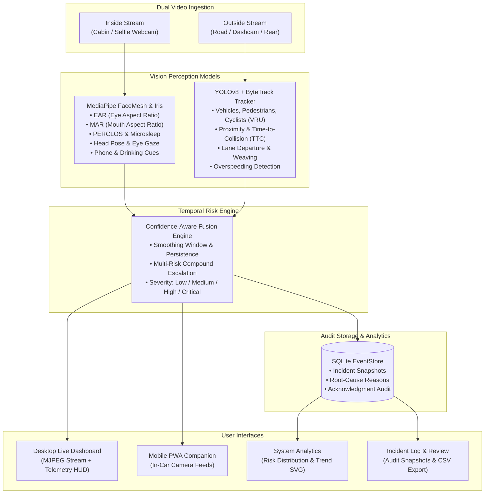

# Dual-Stream Intelligent Driving Safety System

An AI-powered real-time dangerous driving detection and risk-mitigation platform. The system continuously ingests and analyzes synchronized **inside-cabin** driver telemetry and **outside-road** traffic telemetry, performing temporal sensor fusion to detect fatigue, distractions, pedestrian hazards, and imminent collision risks.

---

## System Architecture



---

## Key Features

- **Driver State Monitoring**: Real-time detection of microsleeps, prolonged eye closure (PERCLOS), yawning, head nod episodes, distraction (glances away from road), handheld phone usage, and unfastened seatbelts.
- **Road Hazard Detection**: Multi-object vehicle tracking with ByteTrack, pedestrian & cyclist (VRU) proximity warnings, rapid approach rate (Time-to-Collision), lane weaving, and speed limit violations.
- **Compound Multi-Risk Fusion**: Intelligently correlates cabin hazards with external road threats (e.g., driver looking at phone while front car is braking immediately escalates to Critical risk).
- **Zero-Lag Live Streaming**: Anti-buffering multipart MJPEG streaming with automated client frame ingestion and reconnect recovery.
- **Audit Storage & Analytics**: SQLite persistence storing incident metadata, inside/outside evidence snapshots, operator acknowledgments, and CSV export.
- **Cross-Platform Responsive Web Interfaces**:
  - **Live Command Dashboard**: `/` (Dual video panels, live gauges, input controls)
  - **In-Car Mobile PWA**: `/mobile` (Optimized for smartphones mounted in vehicle)
  - **Risk Analytics**: `/analytics` (Distribution charts, category breakdown, score trends)
  - **Incident Review**: `/incidents` (Filterable incident table, snapshot modals, acknowledgment actions)

---

## Quick Start

### Prerequisites
- Windows 10/11 or Linux
- Python 3.11 (`.venv` virtual environment recommended)
- Webcams (or recorded MP4/AVI videos for evaluation)

### Running Locally
To launch the server with automated virtual environment check:
```powershell
.\start_project.bat
```
Or with PowerShell:
```powershell
.\start_project.ps1
```
Or manually via Uvicorn:
```powershell
python -m uvicorn app.main:app --host 0.0.0.0 --port 8000
```
Open your browser at **`http://localhost:8000`**.

### Remote / Mobile Sharing (Cloudflare Tunnel)
To test the mobile companion on a smartphone over cellular or remote networks:
```powershell
.\start_tunnel.bat
```
Share or open the generated `*.trycloudflare.com` URL on your mobile device.

---

## Project Structure

```text
c:\FYP_1\
├── app\
│   ├── core\
│   │   └── state.py               # InsideState, OutsideState, FusedState dataclasses
│   ├── fusion\
│   │   └── risk_engine.py         # Temporal multi-risk assessment & escalation
│   ├── models\
│   │   ├── inside_monitor.py      # MediaPipe driver fatigue/distraction analyzer
│   │   └── outside_monitor.py     # YOLOv8 + ByteTrack road hazard analyzer
│   ├── services\
│   │   └── system_service.py      # DualStreamService lifecycle, streaming & ingestion
│   ├── static\
│   │   ├── index.html / app.js    # Desktop Live HUD interface
│   │   ├── analytics.html / js    # Statistical risk charts & trend analytics
│   │   ├── incidents.html / js    # Audit incident log with snapshot viewer
│   │   └── mobile\                # Mobile PWA companion (manifest, sw.js, camera view)
│   ├── storage\
│   │   └── event_store.py         # SQLite persistence, snapshot saving, CSV export
│   ├── config.py                  # Pydantic system settings & environment loader
│   └── main.py                    # FastAPI application routes & streaming endpoints
├── data\
│   ├── events\                    # High-risk snapshot image evidence
│   ├── uploads\                   # Uploaded evaluation video recordings
│   └── phase1.db                  # SQLite database
├── tests\
│   ├── __init__.py
│   └── test_system_integrity.py   # Comprehensive 27-point system integrity suite
├── evaluate.py                    # 11-scenario benchmark evaluation script
├── start_project.bat / .ps1       # Automated startup launchers
├── start_tunnel.bat / .ps1        # Cloudflare public tunnel launcher
├── requirements.txt               # Python package dependencies
├── Dockerfile                     # Production container image definition
└── README.md                      # Project documentation
```

---

## Verification & Evaluation

Run the automated verification suite:
```powershell
python test_system_integrity.py
```
*Result: 27/27 checks passed (100.0%)*

Run the multi-hazard scenario evaluation suite:
```powershell
python evaluate.py
```
*Result: 11/11 scenarios passed with 100.0% classification accuracy.*
